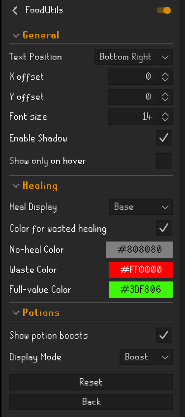

# FoodUtils

A quality-of-life RuneLite plugin that displays consumable values directly on inventory items.

---

## ✨ Features

- Calculates how much you will actually gain based on current stats
- Supports both food and potion effects
- Handles special cases like anglerfish, brews, and multi-effect items
- Customizable display, positioning, and colors

---

## ⚖️ Mixed Consumables

Some items both heal and boost stats.

You can choose how these are displayed:

- **Heal mode** → shows healing values
- **Boost mode** → shows stat boosts

This prevents overlapping overlays.

---

## ⚙️ Customization

### Display
- Text position (6 options)
- Adjustable font size
- X/Y offset
- Optional hover-only display
- Optional text shadow

### Value Modes
- Base value
- Effective value (after waste)
- Both

### Colors
- Full value
- Partial waste
- No value

### Potions
- Toggle potion overlays
- Mixed consumable mode

---

## 🖼️ Examples

*HP is 99 but currently reduced (e.g. rock cake), so effective healing is lower.*

| Base | Effective | Both |
|------|----------|------|
|  |  |  |

---

## 🧰 Menu

---

## 🚀 Version

**v1.2.0**
- Added potion boost overlay
- Added mixed consumable handling
- Switched food handling to RuneLite item stat system
- Improved overlay accuracy  