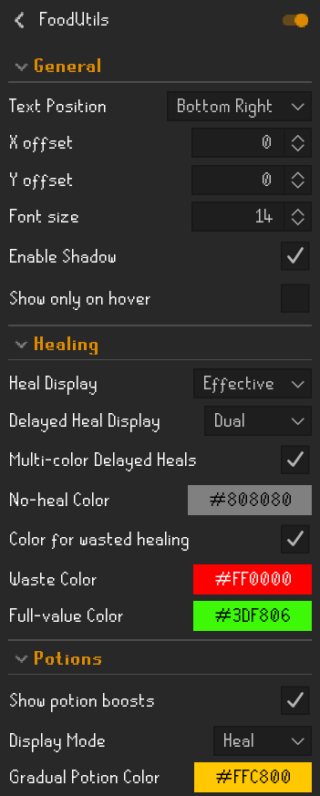

# FoodUtils

A quality-of-life RuneLite plugin that displays consumable values directly on inventory items.

---

## ✨ Features

- Calculates how much you will actually gain based on current stats
- Supports both food and potion effects
- Handles special cases like anglerfish, brews, and multi-effect items
- Customizable display, positioning, and colors

---

## 🖼️ Examples

*HP is 99 but currently reduced (e.g. rock cake), so effective healing is lower.*

| Base | Effective | Both |
|------|----------|------|
|  |  |  |

---

## 🧰 Menu

  

---

## ⚖️ Mixed Consumables

Some items both heal and boost stats.

You can choose how these are displayed:

- **Heal mode** - shows healing values
- **Boost mode** - shows stat boosts

This prevents overlapping overlays.

---

## 🍖 Delayed Heal Foods

Some foods heal in two stages rather than all at once. Hunter meats heal an initial amount immediately, then heal again after 7 ticks (4.2 seconds).

The plugin correctly accounts for both stages and shows the full value. You can configure how the heal is displayed:

| Mode | Shows |
|------|-------|
| Base | Immediate heal only |
| Delayed | Delayed heal only |
| Dual | Both portions (e.g. +13-10) |

In Dual mode you can enable multicolor, which colors each portion separately based on whether that portion is wasted at your current HP.

---

## 🐛 Bugs and Suggestions

If you notice any bugs or have suggestions, feel free to use the Issues link in the top right and I'll work on it when I have time.

---

## 🚀 Version

**v1.21**
- Added support for hunter meats with two-stage delayed healing (immediate + 7 tick delay)
- Added dual/split display mode for delayed heal foods with optional per-portion coloring
- Added prayer regeneration potion support (gradual restore shown with ~ prefix in gold)
- Fixed hunter meat heal totals - previously only the first heal stage was shown
- Fixed strawberry heal formula (was using incorrect rounding)
- Added basket of strawberries support (all 5 dose variants)
- Added Armadyl brew, Guthix rest, and Haddock support
- Blocked TOA-specific items and Menaphite remedy to avoid misleading display values
- Blocked Bluefin tuna from potion overlay (food item, not a potion)

**v1.2.0**
- Added potion boost overlay
- Added mixed consumable handling
- Switched food handling to RuneLite item stat system
- Improved overlay accuracy
